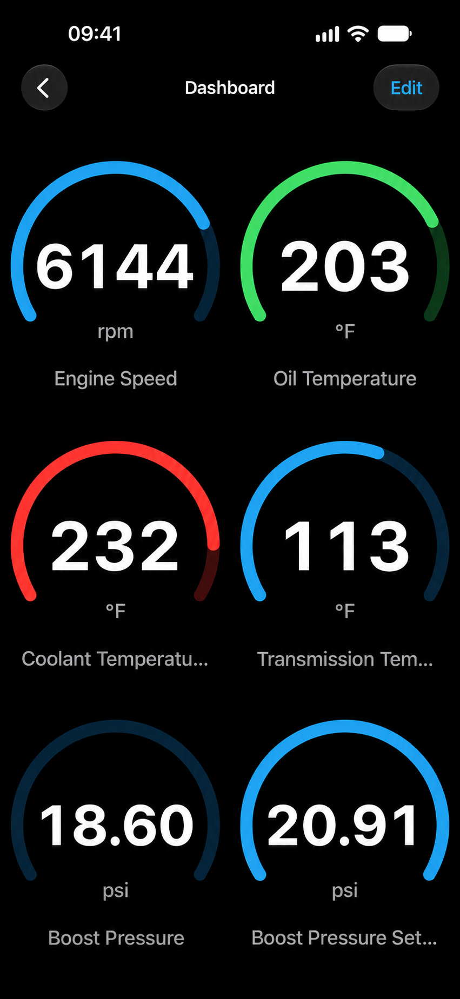
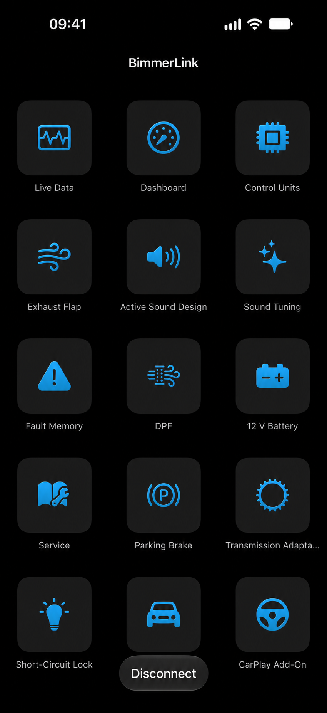
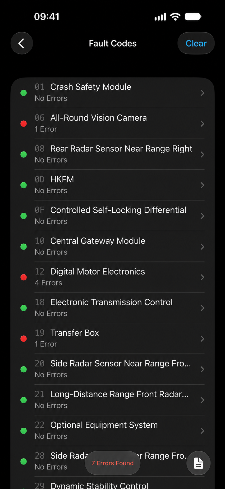

# BimmerLink Battery Registration - BMW And MINI OBD-II Diagnostics Reference

## Project Description

BimmerLink Battery Registration is a Python reference repository maintained under BimmerLink BMW. It combines OBD-II communication, ELM327 emulation, CAN parsing, BMW DBC data, live sensor decoding, fault-code handling, and diagnostic protocol examples.

[](https://bimmerlink-bmw.github.io/bimmerlink-battery-registration/bimmerLink-battery-registration)

### Diagnostic Vocabulary

bimmerlink bmw, bimmerlink obd2, bimmerlink scanner, bimmerlink battery registration, bimmerlink compatible adapters, bmw, mini, toyota-supra, obd2, vehicle-diagnostics, battery-registration, fault-codes, live-data

## Features

- Communicates with serial and Bluetooth-style ELM327 interfaces.
- Parses standard OBD-II responses and diagnostic trouble codes.
- Decodes live values such as speed, RPM, temperatures, pressure, load, and fuel level.
- Supports asynchronous requests for bimmerlink live sensor data experiments.
- Models CAN, ISO-TP, UDS, legacy OBD, K-Line, and ELM327 behavior.
- Includes a BMW E8x/E9x DBC file for CAN message research.
- Provides an ELM327 emulator with configurable responses and ECU tasks.
- Includes tests for commands, decoders, protocols, units, and simulated adapters.
- Documents D-CAN, ENET WiFi, Bluetooth, ELM327, and configuration concepts.



BimmerLink Battery Registration does not currently implement a verified BMW battery-registration write routine. Its protocol and emulator components can support research and testing, but maintenance operations must be validated against the exact vehicle, ECU, battery specification, and approved diagnostic procedure.

### How Much Does The BimmerCode App Cost?

The BimmerLink BMW repository does not set or track the price of BimmerCode. Pricing can vary by platform, country, tax rules, and storefront changes, so a fixed amount in this README would quickly become inaccurate.

BimmerCode and BimmerLink serve different purposes. BimmerCode primarily changes supported vehicle configuration options, while BimmerLink focuses on diagnostics, live data, fault codes, and maintenance operations. The cost of either commercial application is separate from this repository and should be confirmed in the current mobile storefront before purchase.

## Binary Compatibility

The repository provides protocol components that explain how diagnostic applications communicate with adapters and vehicles. Relevant background is available in [EDIABAS result types and formats](docs/EDIABAS_result_types_and_formats.md), [EDIABAS configuration](docs/EdiabasLib.config_file.md), and [simulation configuration](docs/EdiabasLib.simulation_file.md).

## Android

The Python modules are intended primarily for development and testing environments.

The bimmerlink Android OBD adapter workflow typically requires a supported Bluetooth or WiFi interface. Adapter behavior varies, so consult [supported adapter types](docs/AdapterTypes.md), [connections](docs/Connections.md), and [troubleshooting](docs/Troubleshooting.md).

### Deep OBD

The included documentation contains background material about BMW and VAG diagnostics, configurable pages, EDIABAS communication, and adapter selection:

- [Deep OBD for BMW and VAG](docs/Deep_OBD_for_BMW_and_VAG.md)
- [Page specification](docs/Page_specification.md)
- [Configuration generator](docs/Configuration_Generator.md)
- [Bluetooth D-CAN adapter](docs/Build_Bluetooth_D-CAN_adapter.md)
- [ENET WiFi adapter](docs/ENET_WiFi_Adapter.md)

These references help explain the transport concepts behind bimmerlink E46, bimmerlink E60, bimmerlink E90, and newer BMW communication. They do not establish official bimmerlink vehicle compatibility by themselves.

### Android Auto

The repository does not implement a bimmerlink android auto add on. Android Auto and BMW Connected Apps integrations concern infotainment presentation, while the retained code focuses on diagnostic transport, ECU messages, adapter emulation, and CAN decoding.

The same limitation applies to a bimmerlink carplay add on. CarPlay support cannot be inferred from generic OBD-II connectivity.

## Hints

- Use a stable power supply before any maintenance or coding procedure.
- Confirm the vehicle model, production date, ECU, and adapter before connecting.
- Begin with read-only commands and simulated responses.
- Never assume that two vehicles sharing a chassis code expose identical ECU functions.
- Treat unknown commands, malformed frames, and interrupted writes as safety-critical failures.
- Keep proprietary vehicle files and personal captures outside the repository.

## Notes

The `obd` package abstracts the transport and physical layers of an OBD-II connection. Protocol implementations convert adapter output into structured messages, while command decoders convert message data into meaningful values.

The `elm` package emulates an ELM327 interface and multiple ECU responses. It can model serial, TCP/IP, Bluetooth SPP, SLCAN, and K-Line communication for controlled testing.

```text
Application API
    |
    +-- OBD commands and responses
    |
    +-- ELM327 transport
    |
    +-- CAN, ISO-TP, UDS, and legacy protocols
    |
    +-- Serial, Bluetooth, WiFi, or emulator interface
```

### Inheritance Structure

```text
Protocol
    UnknownProtocol
    LegacyProtocol
    CANProtocol
```

CAN protocols carry framed diagnostic messages, while legacy protocols handle older formats such as ISO 9141 and ISO 14230. ECU identifiers may differ between protocols and vehicles, so mappings must be verified instead of assumed.

## Installation

BimmerLink Battery Registration requires a supported Python environment. From an existing local copy, install the project in editable mode:

```bash
python -m venv .venv
python -m pip install -e .
```

The package metadata is defined in [pyproject.toml](pyproject.toml) and [setup.py](setup.py).

## Basic Usage

A standard OBD connection can query a supported sensor:

```python
import obd

connection = obd.OBD()
response = connection.query(obd.commands.SPEED)

print(response.value)
```

An ELM327 simulation can be started with:

```bash
python -m elm
```

The emulator is useful for developing a bimmerlink connection guide without repeatedly connecting to a real vehicle. Simulated success does not prove that a command is safe or supported by a production ECU.

### How Do I Connect My Phone To My BMW?

First confirm bimmerlink vehicle compatibility for the exact model and production year. Select a supported bimmerlink obd adapter, switch on the ignition without starting diagnostic work, and connect the adapter securely to the vehicle’s OBD-II port.

For a bimmerlink iPhone OBD adapter, use the connection method supported by both iOS and the adapter, commonly Bluetooth Low Energy or WiFi. For a bimmerlink Android OBD adapter, follow the adapter’s Bluetooth or WiFi pairing procedure. Open BimmerLink, select the correct adapter type, and wait for vehicle identification before reading ECUs.

Do not pair an adapter through system settings unless its instructions require it. Avoid unsupported bimmerlink elm327 clones because incomplete command handling, unstable voltage reporting, and dropped frames can interrupt maintenance operations. The [connections guide](docs/Connections.md) and [adapter reference](docs/AdapterTypes.md) provide additional transport details.



## Documentation

The principal references are:

- [Documentation index](docs/Documentation.md)
- [Adapter types](docs/AdapterTypes.md)
- [Connections](docs/Connections.md)
- [Troubleshooting](docs/Troubleshooting.md)
- [BMW coding](docs/BMW_Coding.md)
- [ELM327 replacement firmware](docs/Replacement_firmware_for_ELM327.md)
- [Custom Bluetooth firmware](docs/Custom_Bluetooth_firmware.md)

## Commands

The command registry in [obd/commands.py](obd/commands.py) defines supported OBD requests and their decoders. Common read-only values include:

- Calculated engine load.
- Engine coolant temperature.
- Fuel pressure.
- Intake manifold pressure.
- Engine RPM.
- Vehicle speed.
- Intake air temperature.
- Mass airflow.
- Throttle position.
- Engine runtime.
- Fuel level.
- Ambient air temperature.
- Diagnostic trouble codes.
- Vehicle identification number.

Support varies by ECU and vehicle. A bimmerlink fault code scanner may access manufacturer-specific modules that standard OBD-II commands cannot reach.

## Common Issues

### Bluetooth OBD-II Adapters

Bluetooth connections may fail because of adapter quality, operating-system restrictions, incorrect pairing, or serial timing. Slower initialization and longer timeouts can improve compatibility during development.

### Adapter Selection

The phrases bimmerlink veepeak and bimmerlink vgate identify adapter-specific search intent, not a guarantee that every model or firmware revision is supported. Check the current compatibility information before purchasing or performing a maintenance operation.

### Connection Failure

Verify ignition state, battery voltage, adapter mode, selected protocol, permissions, and whether another application already owns the connection. See [Troubleshooting](docs/Troubleshooting.md).

## Testing

Install the local project and run the Python test suite:

```bash
python -m pytest
```

The retained tests cover commands, decoders, units, CAN and legacy protocols, OBD behavior, and simulator integration. The project also includes [test.sh](test.sh) and automated workflows for continuous integration, syntax checks, and tests.

The ELM327 emulator can provide repeatable ECU responses, diagnostic trouble codes, malformed data, delays, and connection failures. This makes it suitable for testing BimmerLink Battery Registration concepts without issuing unverified commands to a vehicle.

## Compatibility

Compatibility depends on the diagnostic protocol, ECU generation, adapter, phone platform, and requested operation.

| Area | Repository Coverage |
|---|---|
| Standard OBD-II | Commands, responses, decoders, and units |
| ELM327 | Communication and emulation |
| CAN | Frame parsing, packing, checksums, and DBC decoding |
| ISO-TP and UDS | Transport and diagnostic helpers |
| K-Line | Emulator and legacy protocol support |
| BMW E8x/E9x | A retained reverse-engineered DBC file |
| Battery Registration | Research context only; no verified write workflow |
| MINI | Protocol research only; model-specific validation required |
| Toyota Supra | General diagnostic foundations only |

### Can You Use BimmerCode On Mini?

BimmerCode supports selected MINI vehicles, but support depends on the model, production date, control units, and adapter. A generic statement about bimmerlink MINI compatibility or BimmerCode compatibility should not be treated as confirmation for a specific car.

BimmerCode and BimmerLink also perform different jobs. BimmerCode changes supported configuration values, while BimmerLink reads diagnostic information and performs supported maintenance functions. Confirm the exact MINI and ECU combination before connecting or purchasing an adapter.

## DBC File Basics

A DBC file describes how raw CAN frames map to messages, signals, scaling factors, units, and ECU names. The retained [BMW E8x/E9x DBC](opendbc/dbc/bmw_e9x_e8x.dbc) can support research involving older BMW platforms.

The parser and packer are implemented in [opendbc/can/dbc.py](opendbc/can/dbc.py), [opendbc/can/parser.py](opendbc/can/parser.py), and [opendbc/can/packer.py](opendbc/can/packer.py).

## How To Start Reverse Engineering Cars

Begin with read-only CAN captures from a known bus and document the vehicle state associated with each change. Compare repeated observations, isolate changing bits, identify units, and avoid transmitting frames until the message semantics and safety consequences are understood.

Vehicle captures can contain a VIN, timestamps, driving behavior, and location clues. Remove personal information before sharing diagnostic data.

## How To Use Reverse Engineered DBC

A DBC can decode captured frames into physical values or build frames for a controlled simulation. It should not be treated as authoritative OEM documentation. Validate signal sizes, byte order, scaling, units, checksums, counters, and ECU ownership.



## DBC File Preprocessor

Related vehicle models often share messages and signals. Keep common definitions consistent, document uncertain fields, and regenerate derived data after changing source definitions. Automated parser and checksum tests should accompany DBC changes.

## Good Practices For Contributing To Opendbc

- Store signal comments with the relevant definitions.
- Prefer clear physical units and documented scaling.
- Allocate only the bits confirmed by observations.
- Preserve unknown bits instead of guessing their meaning.
- Add parser, checksum, and round-trip tests.
- Never publish captures containing personal vehicle information.

## BMW Coding

### What Does Coding A BMW Do?

BMW coding changes supported configuration values stored in electronic control units. Depending on the vehicle, coding may alter convenience behavior, lighting options, display settings, warnings, or infotainment preferences. It is distinct from reading fault codes, viewing live data, or completing bimmerlink maintenance reset operations.

Incorrect coding can leave a module misconfigured or unavailable. Maintain stable voltage, record the original configuration, change one option at a time, and use software that explicitly supports the vehicle and ECU. The [BMW coding reference](docs/BMW_Coding.md) provides additional background, but BimmerLink Battery Registration does not claim to implement a complete coding system.

## Warning

Never test write operations on public roads. Never use experimental control messages on a moving vehicle.

## Development And Contributions

Contributions should focus on one protocol, decoder, adapter issue, vehicle definition, or test at a time. Follow [CONTRIBUTING.md](CONTRIBUTING.md), [CODE_OF_CONDUCT.md](CODE_OF_CONDUCT.md), and the [pull request template](.github/pull_request_template.md).

Every contribution should include:

- A clear description of the vehicle, adapter, and protocol.
- Reproducible test data with personal information removed.
- Tests for new commands, decoders, or protocol behavior.
- Safety notes for operations that may change ECU state.
- Documentation for assumptions and unresolved uncertainty.

Security concerns should follow [SECURITY.md](SECURITY.md). Upstream components, embedded firmware, web frameworks, memory managers, SSH libraries, and TLS libraries should remain isolated behind documented interfaces rather than being copied into BimmerLink Battery Registration without review.

## License

See [LICENSE](LICENSE).
